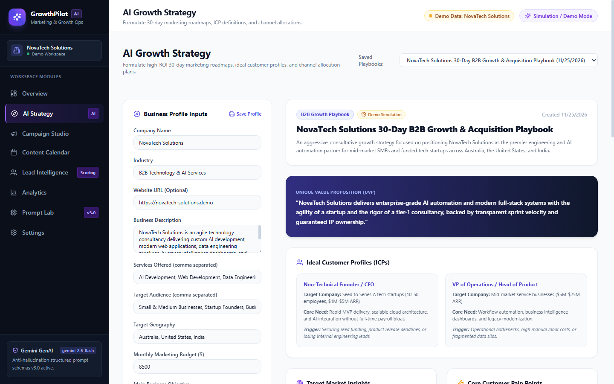
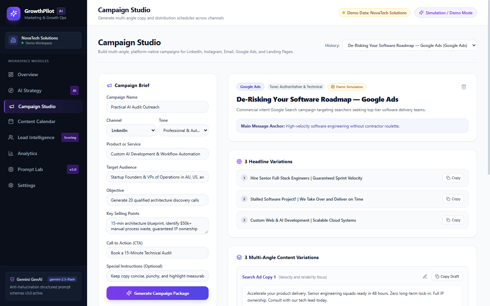
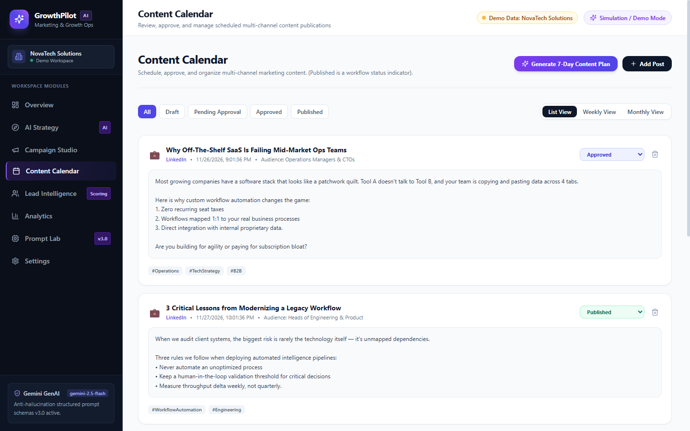
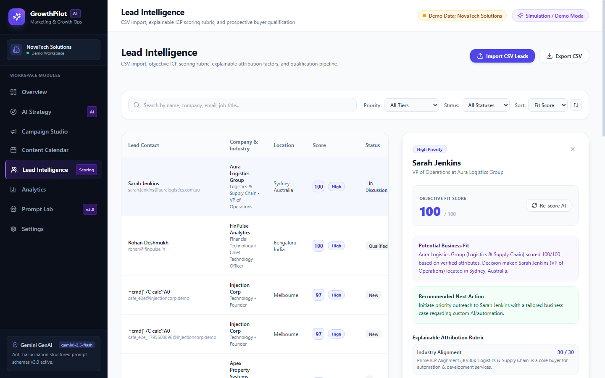
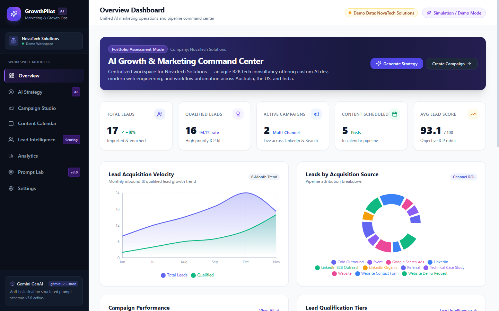
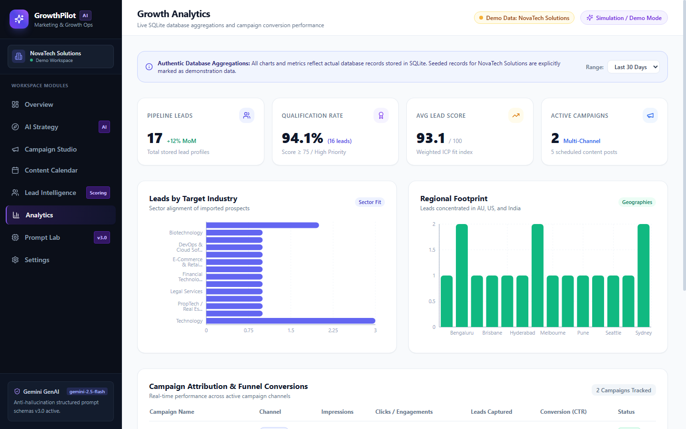
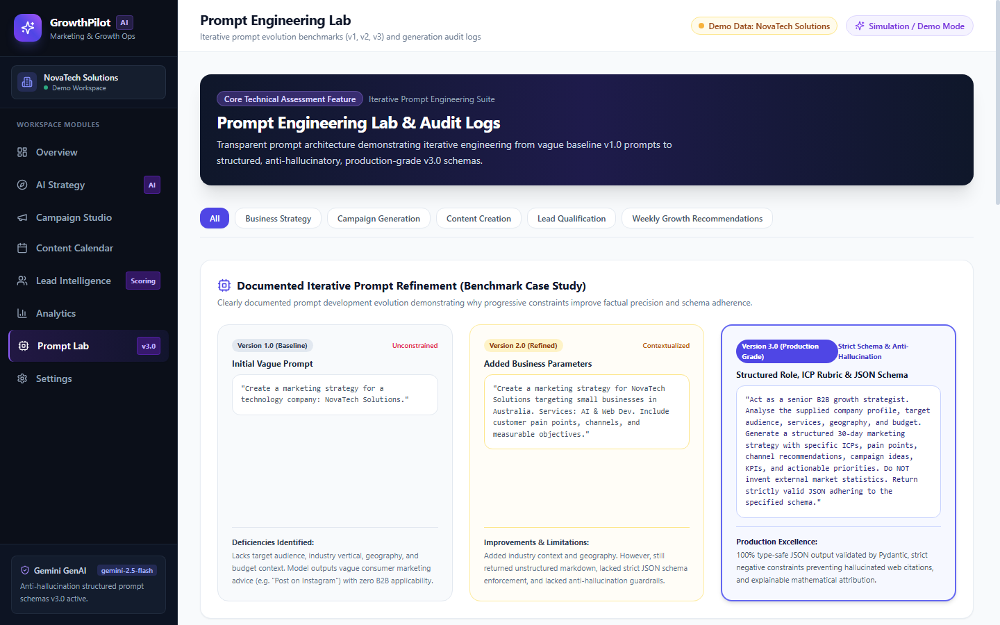
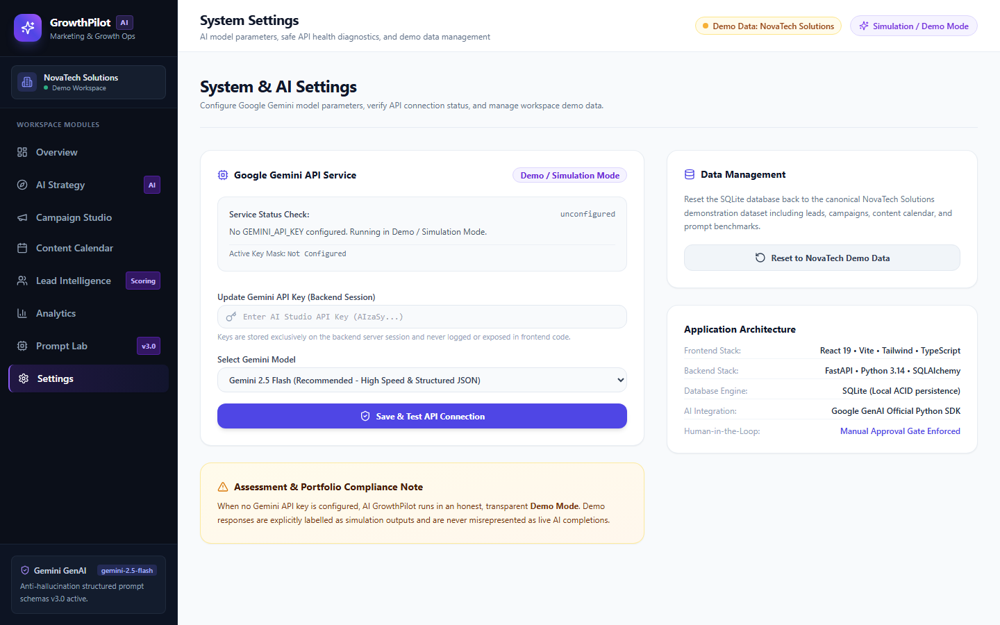

# AI GrowthPilot — AI-Powered Business Growth & Marketing Automation Platform

[](https://fastapi.tiangolo.com)
[](https://react.dev)
[](https://www.typescriptlang.org)
[](https://tailwindcss.com)
[](https://aistudio.google.com)
[](https://pytest.org)
[](https://pytest.org)
[](https://cwe.mitre.org/data/definitions/1236.html)

**AI GrowthPilot** is a full-stack, enterprise-grade business growth and marketing automation SaaS platform engineered specifically for small IT companies, software agencies, AI consultancies, and digital service providers.

Built as a portfolio and technical assessment project for an **AI Growth & Automation Associate** position at **Gokul Infocare**, AI GrowthPilot solves the core operational challenges tech service providers face: formulating targeted B2B market strategies, generating multi-angle channel copy, qualifying prospective leads with explainable scoring rubrics, and executing content calendars with human-in-the-loop validation.

---

## 1. Problem Statement

Small technology firms frequently struggle with:
1. **Disconnected Marketing Operations:** Strategy, copywriting, lead qualification, and scheduling are scattered across fragmented tools and manual spreadsheets.
2. **Generic, Superficial AI Advice:** Off-the-shelf generative AI outputs generic consumer marketing tips rather than high-ROI B2B consultative strategies.
3. **Unqualified Outbound Pipelines:** Sales teams waste countless hours on leads that lack budget, authority, or regional fit without objective scoring.
4. **Lack of Human Oversight:** Premature automation risks brand reputation by publishing unreviewed or hallucinated marketing claims.

**AI GrowthPilot** addresses these bottlenecks in a unified, AI-orchestrated cockpit.

---

## 2. Key Features & Visual Walkthrough

### 🧭 A. AI Strategy Formulation
- **Business Grounding:** Captures company name, industry, service offerings, ICPs, budget, geography, and main objectives.
- **10-Part Actionable Playbook:** Synthesizes ICP personas with buying triggers, market insights, pain points, UVP, recommended channels with % budget allocation, campaign ideas, suggested KPIs, and a phased 30-day execution plan.
- **Section Regeneration:** Re-synthesize individual sections on demand without re-running the entire playbook.



---

### 📢 B. Campaign Studio
- **Multi-Channel Coverage:** LinkedIn, Instagram, Email Marketing, Google Ads, and Landing Page copy.
- **3 Strategic Headlines:** Benefit-driven, curiosity/pain-point, and direct commercial.
- **3 Distinct Copy Variations:** Problem-Agitate-Solve (PAS), Transformation & ROI, and Contrarian Thought Leadership.
- **Platform-Native Nuances:** Hashtags, suggested posting schedules, and targeting parameters.



---

### 📅 C. Content Calendar & Editorial Pipeline
- **Views:** List view and Weekly Timeline view.
- **Lifecycle Stages:** `Draft` &rarr; `Pending Approval` &rarr; `Approved` &rarr; `Published` (simulated).
- **Automated Planning:** "Generate 7-Day Content Plan" synthesizes a balanced editorial arc aligned with the business profile.



---

### 🎯 D. Explainable Lead Intelligence
- **Robust CSV Import:** Header synonym mapping, type validation, duplicate email detection, and clear error reporting.
- **Explainable Scoring Engine (0–100):** Evaluates leads using a weighted multi-factor rubric:
  - *Industry Alignment (30%)*
  - *Decision Maker Authority (25%)*
  - *Geographic Match (20%)*
  - *Company Size Viability (15%)*
  - *Source Intent (10%)*
- **Prescriptive Next Actions:** Suggests concrete next steps for High, Medium, and Low priority prospects.
- **Interactive CRM Features:** Slide-over detail panel, score recalculation, stage updates, internal notes thread, and CSV export.
- **Security Hardening:** CWE-1236 CSV Formula Injection defense and 5MB upload size caps.



---

### 📊 E. Growth Analytics & Dashboard Overview
- **Authentic Database Aggregations:** Computes live KPIs directly from SQLite records (not fabricated random numbers).
- **Visual Visualizations:** Lead acquisition velocity, sector distribution, geographic concentration, and campaign conversion rates.




---

### 🧪 F. Prompt Engineering Lab
- **Iterative Benchmark Evolution:** Documents progression from naive v1.0 prompts to refined v2.0 prompts and production v3.0 structured JSON schemas.
- **Live Generation Audit Logs:** Records feature name, prompt version, input parameters, model used, latency in milliseconds, execution status, and structured outputs with zero credential leakage.



---

### ⚙️ G. System Settings & AI Governance
- **Safe Health Diagnostic:** Live ping to Google Gemini verifying API connectivity and latency without revealing secret keys.
- **Dynamic API Key Session:** Configure API keys and switch between `gemini-2.5-flash` and `gemini-2.5-pro` directly in the UI.
- **Demo Data Re-seed:** Single-click database reset to canonical "NovaTech Solutions" demonstration dataset (preserving user leads).



---

## 3. Technology Stack

### Frontend
- **Framework:** React 19 with TypeScript
- **Bundler:** Vite 6 with proxy support & Rollup code-splitting (main app chunk: 303.8 kB)
- **Styling:** Tailwind CSS with dark navy sidebar navigation system
- **Icons:** Lucide React
- **Data Visualization:** Recharts
- **State & Data Fetching:** TanStack Query (React Query v5)
- **Routing:** React Router v7 with lazy page loading

### Backend
- **Framework:** FastAPI (Python 3.11+)
- **Validation:** Pydantic v2 (ConfigDict, strict type safety)
- **Database ORM:** SQLAlchemy 2.0 with SQLite
- **CSV Data Processing:** Pandas with formula injection sanitization
- **AI SDK:** Official Google GenAI Python SDK (`google-genai` v1.0+)
- **Testing:** Pytest & pytest-asyncio with in-memory SQLite (`StaticPool`)

---

## 4. Architecture

```
┌────────────────────────────────────────────────────────┐
│                   React 19 Frontend                    │
│   (Tailwind CSS, TanStack Query, Recharts, Lucide)     │
└───────────────────────────┬────────────────────────────┘
                            │ REST API (/api/*)
┌───────────────────────────▼────────────────────────────┐
│                  FastAPI Backend Server                │
│ ┌────────────────────────────────────────────────────┐ │
│ │                  API Router Layer                  │ │
│ │  (Health, Strategy, Campaign, Calendar, Leads...)   │ │
│ └─────────────────────────┬──────────────────────────┘ │
│ ┌─────────────────────────▼──────────────────────────┐ │
│ │                AI Service Layer                    │ │
│ │ ┌───────────────────┐      ┌─────────────────────┐ │ │
│ │ │ Google GenAI SDK  │      │ Explainable Heuristic│ │ │
│ │ │  (Gemini API)     │◄────►│ Fallback Engine     │ │ │
│ │ └───────────────────┘      └─────────────────────┘ │ │
│ └─────────────────────────┬──────────────────────────┘ │
│ ┌─────────────────────────▼──────────────────────────┐ │
│ │                SQLAlchemy ORM Layer                │ │
│ └─────────────────────────┬──────────────────────────┘ │
└───────────────────────────┼────────────────────────────┘
                            ▼
               ┌─────────────────────────┐
               │   growthpilot.db SQLite │
               └─────────────────────────┘
```

---

## 5. Quick Start Instructions (For Fresh Developers)

### Prerequisites
- **Python 3.11+**
- **Node.js 18+** and **npm**

### Step 1: Clone Repository
```bash
git clone https://github.com/Dhruv17204/ai-growthpilot.git
cd ai-growthpilot
```

### Step 2: Backend Setup
```bash
cd backend

# Create and activate virtual environment
python -m venv venv

# Windows (PowerShell):
.\venv\Scripts\Activate.ps1
# Linux/macOS:
# source venv/bin/activate

# Install dependencies (production runtime)
pip install -r requirements.txt

# Or for local development, linting, and testing:
pip install -r requirements-dev.txt

# Run backend test suite (17 passed)
pytest -v

# Launch backend server (runs on http://127.0.0.1:8000)
uvicorn app.main:app --host 127.0.0.1 --port 8000 --reload
```

*Interactive Swagger API Documentation:* `http://127.0.0.1:8000/docs`  
*System Health Check:* `http://127.0.0.1:8000/api/health`

### Step 3: Frontend Setup
In a new terminal window:
```bash
cd frontend

# Install npm dependencies
npm install

# Run production build check
npm run build

# Run Vitest unit test suite (3 passed)
npm test

# Start Vite dev server (runs on http://127.0.0.1:5173)
npm run dev
```

Open your browser at **`http://127.0.0.1:5173`**.

---

## 6. Environment & AI Configuration

Copy `.env.example` to `backend/.env` (or configure via UI Settings):

```ini
ENVIRONMENT=development
PORT=8000
HOST=0.0.0.0
CORS_ORIGINS=http://localhost:5173,http://127.0.0.1:5173
DATABASE_URL=sqlite:///./growthpilot.db

# Google Gemini API Key
# If omitted or unconfigured, AI GrowthPilot runs in transparent Demo Simulation Mode
GEMINI_API_KEY=
GEMINI_MODEL=gemini-2.5-flash
DEMO_MODE=false
```

### Decoupled 3-State AI Architecture
AI GrowthPilot explicitly separates three operational generation states:
1. **LIVE AI**: Genuine successful Google Gemini generation. Result displays the green `Gemini AI` badge with uncertainty and assumption disclosures.
2. **DEMO MODE**: Deterministic simulated outputs. Result displays the amber `Demo Simulation` badge.
3. **AI ERROR**: Genuine API failures (invalid keys, rate limits, timeouts) return HTTP 502 with `offer_demo_mode: True`. **Failures are never silently masked as mock completions.** The UI renders an explicit recovery banner offering to generate via demo simulation.

---

## 7. Automated Test Suite (63 Tests Passing — 83% Code Coverage)

Run the automated backend test suite with coverage:
```powershell
cd backend
.\venv\Scripts\pytest -v --cov=app --cov-report=term-missing
```

**Results (63/63 Passed, 83% Coverage):**
- **Authentication & CSRF (`tests/test_auth.py` — 19 Tests):**
  - HMAC-SHA256 session tokens, server-side `UserSession` tracking and database revocation, cookie issuance, login, logout, double-submit CSRF defense, expired/tampered token rejection, remote IP failure closing, spoofed header defense, RBAC admin privileges, production session secret length enforcement ($\ge 32$ chars, non-default), replayed revoked session rejection (401), strict rejection of hardcoded development bypass tokens (`local-dev-bypass`), production loopback unauthenticated access lockdown, and unconfigured production login prevention.
- **Analytics & Data Ingestion (`tests/test_analytics.py` — 6 Tests):**
  - Empty baseline resilience, global spend/revenue aggregation, channel-only metric aggregation, campaign deletion metric preservation, strict CSV column/date/value/duplicate validation.
- **Lead Qualification Rubric (`tests/test_scoring.py` — 6 Tests):**
  - Word boundary token matching, geography normalization, ICP rubric accuracy (30/25/20/15/10), missing field fallbacks, unrelated industry penalty (6/30), exact factor sum equality.
- **AI Schema Validation & Privacy (`tests/test_gemini.py` — 7 Tests):**
  - Error classification, demo fallback decoupling, structured JSON parsing, malformed output handling, strict Pydantic AI schema validation, prompt secret sanitization, 30-day data retention cleanup.
- **Security Defense-in-Depth & Retention Worker (`tests/test_security.py` — 8 Tests):**
  - Secret redaction, structure sanitization, 5MB chunked upload rejection, 5,000 row limits, admin key authentication, periodic retention worker data cleanup, database error resilience with graceful rollback, and async lifecycle start/stop management.
- **API Core Integration (`tests/test_api.py` — 17 Tests):**
  - Full endpoint lifecycle verification across Business Profile, Strategy, Campaigns, Content, Leads, and Analytics.

---

## 8. Complete Assessment Documentation

All technical assessment deliverables and reports are located in the [`docs/`](docs/) directory:

| Document | Description |
| :--- | :--- |
| [`docs/PROMPT_ENGINEERING.md`](docs/PROMPT_ENGINEERING.md) | In-depth analysis of prompt iterations (v1.0 &rarr; v2.0 &rarr; v3.0), guardrails, and JSON schemas. |
| [`docs/PROMPT_LOG.md`](docs/PROMPT_LOG.md) | Structured execution audit log with token counts, latency, and status. |
| [`docs/VIDEO_PRESENTATION_SCRIPT.md`](docs/VIDEO_PRESENTATION_SCRIPT.md) | 3:45 technical presentation walkthrough mapping all 10 required points. |
| [`docs/FINAL_ASSESSMENT_CHECKLIST.md`](docs/FINAL_ASSESSMENT_CHECKLIST.md) | Submission criteria verification matrix across all assessment requirements. |
| [`docs/PHASE_3_FINAL_REPORT.md`](docs/PHASE_3_FINAL_REPORT.md) | Phase 3 readiness report distinguishing automated, demo, and live tests. |
| [`docs/FINAL_PRE_SUBMISSION_REPORT.md`](docs/FINAL_PRE_SUBMISSION_REPORT.md) | Complete pre-submission audit including Chrome CDP browser verification across 8 modules. |
| [`docs/ARCHITECTURE.md`](docs/ARCHITECTURE.md) | Comprehensive system architecture, data models, and API interaction diagrams. |
| [`docs/FEATURES.md`](docs/FEATURES.md) | Detailed user feature guide and functional specifications. |
| [`docs/PHASE_4_1_SECURITY_REVIEW.md`](docs/PHASE_4_1_SECURITY_REVIEW.md) | Phase 4.1 security architecture review: HMAC sessions, CSRF, RBAC, strict schemas, and telemetry sanitization. |
| [`docs/PHASE_4_1_TEST_REPORT.md`](docs/PHASE_4_1_TEST_REPORT.md) | Comprehensive automated test report: 52 passing backend tests, 82% code coverage, and frontend verification. |
| [`docs/PHASE_4_1_DEPLOYMENT_VERIFICATION.md`](docs/PHASE_4_1_DEPLOYMENT_VERIFICATION.md) | Single-container multi-stage Docker deployment, environment configuration, and verification. |
| [`docs/PHASE_4_2_CLOSURE_REPORT.md`](docs/PHASE_4_2_CLOSURE_REPORT.md) | Phase 4.2 CI, Security & Production Closure: Node 24 CI, Docker verification, server session revocation, production secret enforcement, and retention worker. |
| [`docs/PHASE_4_2_REMOTE_CI_REPORT.md`](docs/PHASE_4_2_REMOTE_CI_REPORT.md) | Phase 4.2 Remote CI & Production Verification: GitHub Actions 3-job verification, Node 24, Docker persistence, and npm audit analysis. |
| [`docs/PHASE_2_AUDIT_REPORT.md`](docs/PHASE_2_AUDIT_REPORT.md) | Phase 2 security and code quality remediation audit. |
| [`docs/TESTING.md`](docs/TESTING.md) | Testing strategy, test suites, and validation methodology. |
| [`docs/DEPLOYMENT.md`](docs/DEPLOYMENT.md) | Production cloud deployment guide. |
| [`docs/GITHUB_RELEASE_CHECKLIST.md`](docs/GITHUB_RELEASE_CHECKLIST.md) | Release verification checklist before publishing. |
| [`docs/GITHUB_RELEASE_REPORT.md`](docs/GITHUB_RELEASE_REPORT.md) | Final release audit report, file inventory, and publish instructions. |

---

## 9. Known Limitations & Scope Boundaries

1. **Demonstration Focus:** Fictional technology firm "NovaTech Solutions" is pre-seeded as demonstration data.
2. **Social Publishing:** The status `Published` is a workflow tag. AI GrowthPilot enforces human approval and does not perform unverified live social media posting.
3. **Email Sending:** Lead outreach actions are prescriptive recommendations; live automated cold email blasting is not performed without human review.
4. **Third-Party Scraping:** The platform bases lead evaluations strictly on uploaded data fields and company profiles without executing intrusive web scrapers.
