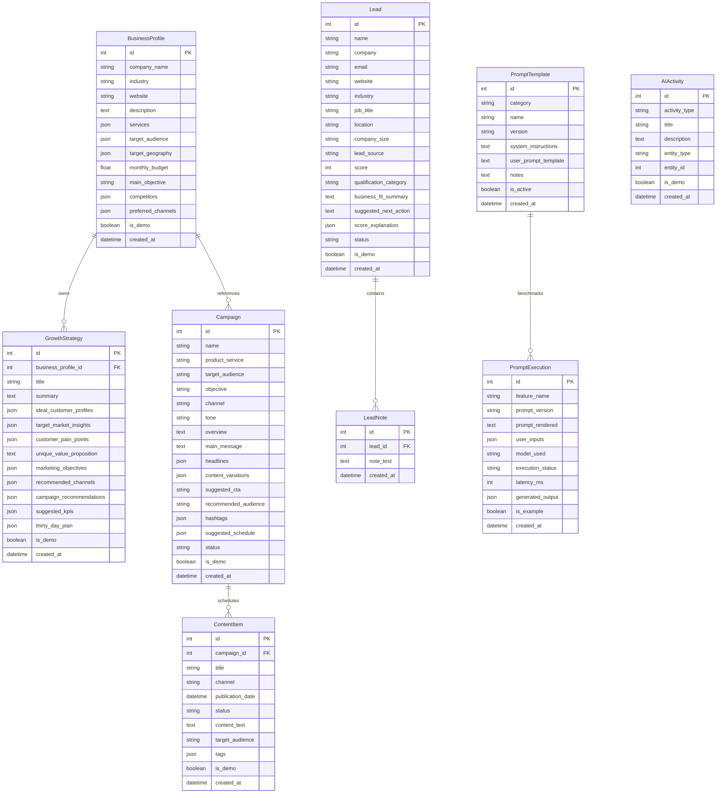

# AI GrowthPilot — Technical Architecture Specification

## 1. Executive Architecture Overview

**AI GrowthPilot** is an enterprise-grade AI-powered business growth and marketing automation platform designed specifically for small-to-midsize B2B technology companies, agencies, and consultancies.

The application follows a modern decoupled client-server architecture with an asynchronous service-oriented backend, local ACID relational persistence, and a native integration layer with the **Google Gemini API** using the official `google-genai` Python SDK.

```
┌────────────────────────────────────────────────────────────────────────┐
│                        AI GrowthPilot Platform                         │
└────────────────────────────────────────────────────────────────────────┘
                               │
            ┌──────────────────┴──────────────────┐
            ▼                                     ▼
┌───────────────────────┐             ┌───────────────────────┐
│   Frontend (SPA)      │             │   Backend (FastAPI)   │
│ • React 19            │   REST API  │ • Python 3.14 / 3.11+ │
│ • TypeScript          │ ──────────► │ • FastAPI REST Router │
│ • Vite 6              │  (JSON/CORS)│ • Pydantic V2 Schemas │
│ • Tailwind CSS        │ ◄────────── │ • SQLAlchemy ORM      │
│ • TanStack Query      │             │ • SQLite Local DB     │
│ • Recharts & Lucide   │             │ • Pandas CSV Engine   │
└───────────────────────┘             └───────────────────────┘
                                                  │
                                                  ▼
                                      ┌───────────────────────┐
                                      │   AI Service Layer    │
                                      │ • GeminiClientWrapper │
                                      │ • Google GenAI SDK    │
                                      │ • Structured JSON     │
                                      │ • Anti-Hallucination  │
                                      │ • Fallback Simulator  │
                                      └───────────────────────┘
                                                  │
                                                  ▼
                                      ┌───────────────────────┐
                                      │   Google Gemini API   │
                                      │ • gemini-2.5-flash    │
                                      │ • Structured Outputs  │
                                      └───────────────────────┘
```

---

## 2. Technology Stack & Decision Rationale

### 2.1 Frontend Tier
| Technology | Version | Purpose & Rationale |
| :--- | :--- | :--- |
| **React** | 19.0 | Core UI rendering engine; utilizes modern hooks and concurrent rendering capabilities. |
| **TypeScript** | 5.7 | Enforces strict compile-time type safety across API schemas, UI components, and state. |
| **Vite** | 6.1 | Next-generation bundler providing instant Hot Module Replacement (HMR) and optimized rollup production bundles. |
| **Tailwind CSS** | 3.4 | Utility-first styling enabling a cohesive design system (Dark navy sidebar `#0B0F19`, violet/indigo accents). |
| **TanStack Query** | 5.66 | Robust asynchronous server state management, caching, background invalidation, and optimistic mutations. |
| **React Router** | 7.2 | Declarative client-side routing across all 8 core platform modules. |
| **Recharts** | 2.15 | Responsive SVG-based charting library for marketing velocity, source attribution, and qualification tiers. |
| **Lucide React** | 0.475 | Clean, accessible vector icons matching Stripe/Linear SaaS aesthetics. |

### 2.2 Backend Tier
| Technology | Version | Purpose & Rationale |
| :--- | :--- | :--- |
| **Python** | 3.14 / 3.11+ | High-performance runtime for AI orchestration and data processing. |
| **FastAPI** | 0.115+ | High-throughput asynchronous ASGI web framework with native OpenAPI/Swagger self-documentation. |
| **Pydantic** | 2.14+ | Strict runtime request/response validation, data parsing, and serialization. |
| **SQLAlchemy** | 2.0+ | Modern Python SQL toolkit and Object Relational Mapper (ORM) ensuring SQL injection immunity. |
| **SQLite** | 3.x | Lightweight, zero-config relational database with ACID compliance, ideal for local execution and self-contained demos. |
| **Pandas** | 2.2+ | Industrial-strength CSV data ingestion, column normalization, and validation engine. |

### 2.3 AI Integration
| Technology | Role | Implementation |
| :--- | :--- | :--- |
| **Google GenAI SDK** | `google-genai` | Official Google Gen AI Python SDK client (`from google import genai`). |
| **Model Selection** | `gemini-2.5-flash` | Optimized for low-latency structured JSON generation with high reasoning capacity. |
| **Structured Output** | JSON Schema | Enforced via `response_mime_type="application/json"` and Pydantic validation. |
| **Demo Mode Fallback** | Deterministic Engine | Provides grounded simulation data when API key is unconfigured, clearly flagged with `is_demo=True`. |

---

## 3. Database Schema & Entity Relationships

The relational model stores all platform state locally in `growthpilot.db`:



---

## 4. Security Architecture

1. **API Key Isolation**:
   - The Gemini API key is maintained **strictly on the backend**.
   - Neither the API key nor secret tokens are ever transmitted to or stored in client-side code, cookies, or browser storage.
   - The `/api/settings/ai-config` endpoint returns an obfuscated key mask (e.g. `...1a2b`) without exposing the credential.

2. **CORS Boundary**:
   - FastAPI CORS middleware is restricted to explicit frontend origins (`http://localhost:5173`, `http://127.0.0.1:5173`) during development.

3. **CSV Ingestion & Export Hardening**:
   - Upload size is strictly restricted to 5MB (`MAX_CSV_BYTES`).
   - File extensions are validated case-insensitively (`.csv`).
   - Pandas parses the stream in memory with encoding fallback (`utf-8` with `latin1` fallback).
   - Duplicate detection on normalized lowercase email prevents table bloat.
   - **Formula Injection Mitigation (CWE-1236)**: Every cell in CSV exports starting with `=`, `+`, `-`, `@`, `\t`, or `\r` is sanitized with a leading single quote `'` to prevent DDE command execution in spreadsheet programs.

4. **SQL Injection Prevention & Data Isolation**:
   - All database reads and writes use SQLAlchemy ORM parameterized queries. Raw user input is never concatenated into SQL statements.
   - **Demo Data Isolation**: When resetting demonstration data (`POST /api/settings/reset-demo`), the backend deletes only records where `is_demo == True`, preserving all user-created leads, campaigns, and strategies.

5. **Decoupled 3-State AI & Credential Security**:
   - The Gemini API key is stored session-only in backend memory and cleared upon restart. Keys are never saved in localStorage, never logged, and never returned in API responses.
   - AI generation strictly decouples **`LIVE AI`**, **`DEMO MODE`**, and **`AI ERROR`**. Live API failures return HTTP 502 with `offer_demo_mode: True`, preventing silent fallback to mock responses.

6. **Human-in-the-Loop Governance**:
   - AI generates marketing collateral into `Draft` status.
   - Status transitions (`Pending Approval` -> `Approved` -> `Published`) require explicit human intervention.
   - No autonomous external publishing or email dispatch is performed.
